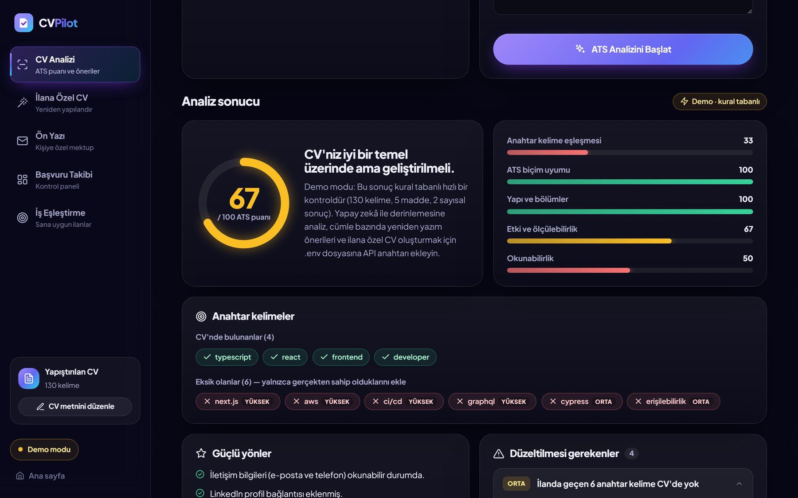
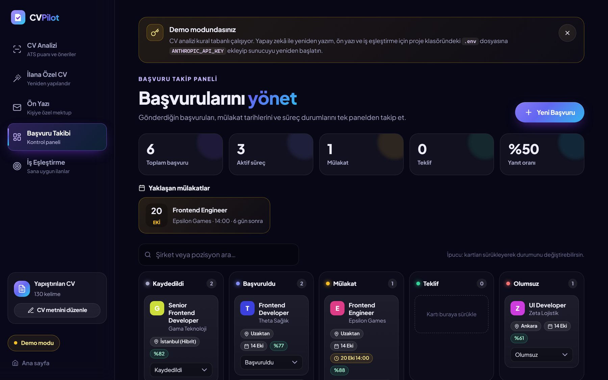
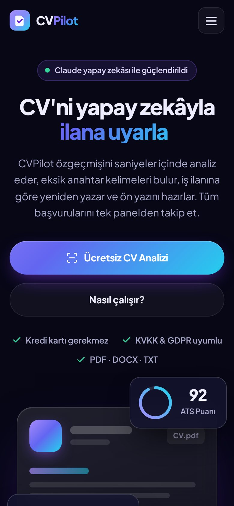

# CVPilot

[](https://github.com/omergazi34/cvpilot/actions/workflows/ci.yml)


[](LICENSE)

**An AI job-application assistant for the Turkish job market.** Upload a CV and CVPilot scores it
the way applicant tracking systems (ATS) and recruiters read it, rewrites it for a specific job
posting, drafts a cover letter, matches you to roles, and tracks your applications on a kanban
board. Built on the Claude API with structured outputs and streaming.

<p align="center">
  
</p>

> The interface is in Turkish because the product targets Turkish job seekers; prompts ask the
> model to answer in Turkish and to keep the CV in its original language. The code and docs are
> in English.

## Features

| | |
|---|---|
| **ATS analysis** | Score out of 100 with five sub-scores (keywords, formatting, structure, impact, readability), issues ranked by severity with concrete fixes, found/missing keywords against the job posting, sentence-level rewrites |
| **Job-specific CV** | Rewrites the CV for a posting, shows before/after scores and every change, exports to **DOCX** (single column, ATS-safe) or PDF (print layout) |
| **Cover letter** | Tone and length controls, streams in live, editable in place |
| **Job matching** | Suggested roles with job-board search links, plus fit scores for postings you paste |
| **Application tracker** | Drag-and-drop kanban, upcoming interviews, response-rate stats, `.ics` calendar export |
| **File intake** | PDF, DOCX, TXT and images. Flags ATS-hostile formatting (tables, icon fonts, contact details in headers, scanned PDFs) and reads scanned files with the model |
| **Demo mode** | Without an API key, a rule-based analyser returns the same JSON shape, so the whole UI works offline |

<p align="center">
  
  
</p>

## How it uses Claude

- **Structured outputs.** Analysis, rewrite and matching responses are constrained by JSON Schemas
  (`output_config.format`), so the UI never parses free text. See [`lib/ai.js`](lib/ai.js).
- **Streaming.** Every model call streams. The server forwards progress to the browser as NDJSON
  events (`phase` → `progress`/`delta` → `result`), so long rewrites show live progress and cover
  letters type themselves out. Closing the tab aborts the upstream request.
- **No fabrication by design.** Prompts forbid inventing employers, dates, skills or numbers. When
  a stronger bullet needs a metric the CV doesn't have, the model inserts a placeholder like `[%X]`,
  which the UI highlights for the candidate to fill in.
- **Reliability.** Typed SDK errors are mapped to actionable user messages (bad key, rate limit,
  model not found…). `refusal` and `max_tokens` stop reasons are handled explicitly, and server-side
  refusal fallback is enabled for models that support it.
- **Vision for scanned CVs.** Image and scanned-PDF CVs are transcribed by sending them as image /
  document blocks.

## Quick start

```bash
git clone https://github.com/omergazi34/cvpilot && cd cvpilot
npm install
cp .env.example .env        # add ANTHROPIC_API_KEY, or leave it empty for demo mode
npm start                   # http://localhost:3000
```

On Windows you can double-click `baslat.bat`: it installs dependencies, creates `.env` and opens
the browser.

| Setting (`.env`) | Default | |
|---|---|---|
| `ANTHROPIC_API_KEY` | – | Enables the AI features; without it the app runs in demo mode |
| `CLAUDE_MODEL` | `claude-opus-5-5` | Model for every request |
| `AI_EFFORT` | `medium` | `low` is faster and cheaper, `high` digs deeper |
| `HOST` / `PORT` | `127.0.0.1` / `3000` | Use `HOST=0.0.0.0` to try it from a phone on the same Wi-Fi |
| `CVPILOT_DATA_DIR` | `./data` | Where the tracker stores its JSON file |

## Architecture

```text
public/                    vanilla JS + CSS, no build step (landing page + single-page app)
  js/app.js                state, rendering (all dynamic HTML escaped), NDJSON stream reader
app.js                     Express 5 app: validation, NDJSON streaming, DOCX export, tracker API
server.js                  port selection, startup banner, --open
lib/
  ai.js                    Claude calls: prompts, JSON schemas, streaming, error mapping
  extract.js               PDF / DOCX / TXT / image → text + ATS formatting checks
  heuristic.js             demo-mode analyser (same output shape as the AI analysis)
  docx.js                  ATS-friendly DOCX generation (TR/EN headings)
  store.js                 JSON-file store with serialised, atomic (temp + rename) writes
```

Design decisions and trade-offs are in [DESIGN.md](DESIGN.md).

## Testing

```bash
npm test               # 33 tests, no network or API key needed
npm run test:coverage  # ~84% line coverage
npm run lint
```

Tests use real files rather than mocks: a valid PDF is generated byte by byte and parsed with the
real PDF parser, DOCX files are created with tables to check the ATS warning, and exported CVs are
read back with mammoth to verify section order. API tests run the Express app on a random port and
consume the NDJSON stream. Writing them caught two user-facing bugs: a short CV was reported as
"required" instead of "too short", and oversized requests returned an English error message.

## Privacy

This is a local application. CV text is sent only to the Anthropic API for analysis, and Anthropic
does not train on API data by default. CV text and results stay in the browser's `localStorage`
and can be wiped from the app ("Yerel verileri sil"). The tracker writes to a JSON file on your
machine. The marketing landing page (pricing, hosting and compliance badges) describes the product
concept; those commitments would have to be provided by whatever infrastructure it is deployed on.

## License

MIT
